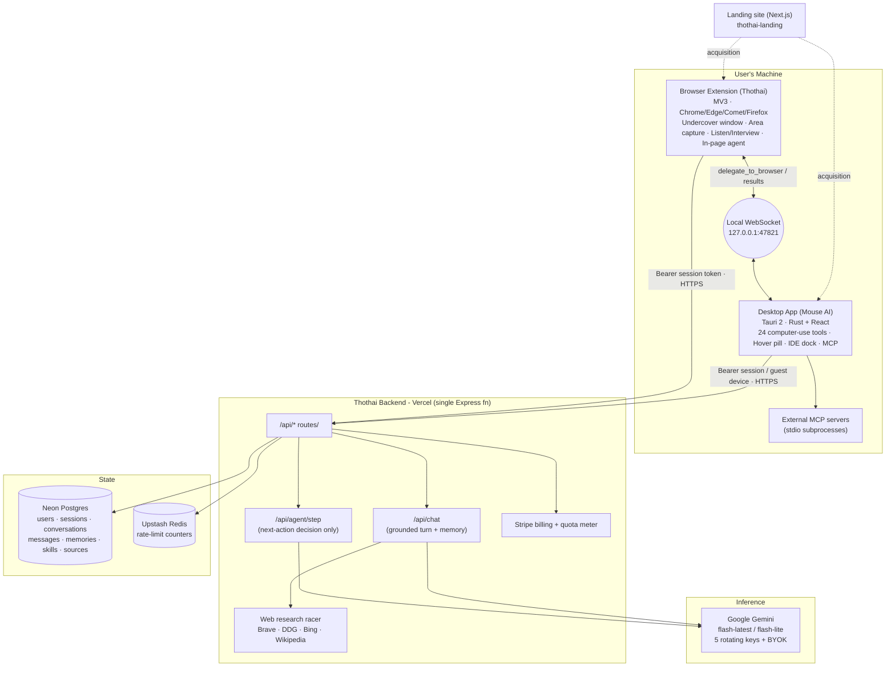

> Brand note (Oct 2026): the products are now Kudu / Kudu Connect / Kudu Desktop; names below are historical.

# Thothai - Master Strategy, Architecture & Path to a $10B Company

> **What this document is.** A single, grounded reference that treats the four repositories
> (`stealth-ai-extension`, `backend-Thothai`, `mouse ai desktop`, `thothai-landing`) as **one
> product: Thothai**. Every capability described below was verified against the actual source
> code in August 2026 - nothing here is aspirational unless it is explicitly marked as
> *Roadmap / Not yet built*. The strategy is deliberately honest: a real path to a very large
> company is built on what is true today plus a disciplined plan, not on marketing claims.

---

## 0. TL;DR

**Thothai is an invisible AI copilot that sees your screen and acts on your computer.** It ships as
a browser extension (the "undercover" assistant, invisible during single-tab screen shares) and a
Windows/Mac desktop app (a true computer-use agent that clicks, types, runs shell commands and edits
files), both backed by one hosted inference service that holds the model keys.

- **Who it's for today:** developers, job-seekers/interviewees, students, researchers, and knowledge
  workers who live across dozens of tabs and want instant, private answers - plus a fast-growing
  "meeting/interview copilot" audience.
- **The wedge (why anyone switches):** *answers in context, without leaving the screen, and without
  it showing up when you share your screen.* No copy-pasting into ChatGPT; no visible assistant.
- **The moat we must build:** the desktop **computer-use agent** - it does not just answer, it does
  the work (fills forms, drives apps, automates the OS). That is far harder to clone than a chat box.
- **The honest tension:** the "invisible during interviews" angle drives virality but is an
  ethical/policy minefield. The durable business is **coaching + real work automation**, with stealth
  as a privacy feature, not a cheating feature. This document takes that position throughout.

**A $10B outcome is achievable only if Thothai becomes the default "AI layer over your whole
computer," not a novelty screen-share trick.** The trick gets the first million users; the agent
keeps them and gets the enterprise.

---

## 1. What Thothai actually is today (verified)

Thothai is four codebases that form one system:

| Repo | Role | Stack (verified) | Maturity |
|---|---|---|---|
| `stealth-ai-extension` | Browser extension "Thothai" - undercover assistant, area capture, page context, listen/interview mode, in-browser agent | MV3, vanilla JS, no bundler, Chrome/Edge/Comet + Firefox build. v1.8.0 | **Feature-rich, shippable** |
| `mouse ai desktop` | Desktop computer-use agent "Mouse AI" | Tauri 2 (Rust backend + React/TS frontend) | **Deep, working, Windows-first** |
| `backend-Thothai` | The only place model keys live; auth, chat, agent-step, history, billing | Node/Express on Vercel, Neon Postgres, Upstash rate-limit, Stripe | **Working, single serverless function** |
| `thothai-landing` | Marketing site | Next.js 16 + Tailwind v4 | **Visually done, conversion flow NOT wired** |

### 1.1 The browser extension (the "invisible" product)

Real, verified capabilities:

- **AI chat with full page context** - assembles URL, title, headings, links, selection and page text
  (8k–15k char limits) into the prompt.
- **Undercover window** - the chat lives in a *separate OS popup window* (`chrome.windows.create({type:"popup"})`),
  so when you share **a single browser tab** in Zoom/Meet/Teams, the assistant is not in the shared
  region. This is structural invisibility, not screen-capture hacking.
- **Stealth area capture (Alt+S)** - drag a box over anything; in undercover mode the selection
  rectangle is hidden on the shared tab and mirrored only into the private window. Auto-analysis
  prompt templates explicitly handle "quiz, homework, interview, exam, multiple choice."
- **Listen / Interview mode** - Web Speech API transcribes the meeting; `interviewMode` prepends a
  concise-spoken-answer / STAR-format instruction; `autoAnswer` detects questions and auto-sends them,
  rendering a dismissible "live answer" card.
- **Research collections** - the Research▾ popover in both UIs now manages source groups end-to-end:
  create a collection, add the current page / picked open tabs / a pasted URL (YouTube, any site) /
  an uploaded file (PDF/txt/md/csv), have the AI **Find** sources on the web and import the ones you
  pick, and remove any of them. Selecting a collection scopes the answer to that curated set. This is
  the "combine pages for research / collaboration" surface.
- **@-mentions & /-commands in the composer** - type `@` to attach the current page, another open tab,
  a research collection, an uploaded file, or the page selection as first-class context (chips above
  the input); type `/` for quick commands (`/summarize`, `/keypoints`, `/explain`, `/table`,
  `/extract`, `/translate`, `/rewrite`, and mode toggles `/act`, `/research`, `/page`, `/selection`).
  Follows the industry `@`=context / `/`=action convention.
- **Multi-tab tab picker** - an undercover page-bar picker to pin one tab or group several as the
  context Thothai reads (and Acts on); "Auto" follows the focused tab.
- **In-browser agent ("Act")** - now **~22 tools**: page tools `read_page, click, fill, press_key`
  (with modifier combos), `scroll, hover, find` (in-page text search), `get_page_text` (paged),
  `wait_for` (poll until text appears/disappears), `get_options`/`select_option` (dropdown/ARIA
  listbox), `drag_and_drop`, `upload_file`; browser tools `navigate, back, new_tab, close_tab,
  screenshot, list_tabs, switch_tab, wait, web_search, web_fetch`; delegation `run_subagent` and
  **`run_subagents`** (up to 4 in parallel, each in its own isolated background tab); and the sandbox
  tool **`run_js`**.
- **In-browser code sandbox (`run_js`)** - the agent can run JavaScript on the page via a locked-down
  `chrome.userScripts` world (CSP-proof - works even on strict sites like GitHub), falling back to
  `executeScript`. Full DOM access, isolated from the page's own JS, ephemeral (leaves nothing behind).
  Every run is **gated behind a human confirmation that shows the code first**.
- **Sensitive-action confirmation** - before the agent clicks anything classified as spending money,
  deleting, sending/publishing, signing out, or moving funds, it pauses and shows an inline Approve /
  Skip card (fail-closed: cancel or 90s timeout = declined). Matches Anthropic/OpenAI agent-safety
  guidance (human-in-the-loop for irreversible actions).
- **Resilient loop** - prunes stale page snapshots to avoid quadratic context growth, injects a
  course-correction nudge after 4 consecutive tool errors, a graceful "wrap up and verify" nudge as
  the step budget runs low, stale-ref detection, and restricted-page fail-fast (won't thrash on the
  Chrome Web Store / add-on galleries Chrome forbids scripting).
- **History, memories, skills, sources** - mirrored to the backend and Postgres.
- **Auth + billing** - Google sign-in; client shows Free / Plus / Pro; Stripe checkout via backend.

> **UI/UX & correctness pass (Aug 2026):** the assistant renders a full Markdown set (headings,
> tables, blockquotes, nested lists, `hr`, strikethrough - no raw `**`/`##`/`---` leaking), each answer
> has a hover **Copy** button, a duplicate-send guard prevents the "same answer twice" bug, the send
> button becomes a **Stop** while the agent runs, and every panel opens on a proper welcome screen with
> one-click suggestion chips. All features work in **both** in-page and undercover modes.

### 1.2 The desktop app (the real moat)

Mouse AI is a genuine **computer-use agent** - the hard, defensible part of the whole company:

- **24 built-in tools** including `run_command` (PowerShell), `read_file/write_file/find_files`,
  `capture_screen`, `get_screen_context`, `list_windows`, `read_app_content` (UI-Automation
  accessibility tree), and full input synthesis (`click/double_click/scroll/type_text/press_key`),
  plus `open_url/open_app/wait`.
- **Observe → act → verify loop** - every screen-changing action auto-attaches a fresh screenshot so
  the model self-corrects (`MAX_ITERATIONS = 40`).
- **Normalized 0–1000 coordinate mapping** so the model's clicks land on the right pixels regardless
  of resolution/DPI.
- **Consent gate** - first time the agent touches any given app in a run, the user must Allow/Deny;
  genuinely destructive shell commands are refused before execution; model-written files land in a
  wiped scratch dir, not your source tree.
- **Hover "Ask AI" pill** - dwell the cursor 550 ms over anything and a context-aware pill appears
  (adaptive light/dark theming by sampling screen luminance).
- **IDE dock** - real CodeMirror editor + file tree, a real PTY terminal (`portable-pty`), and a git
  changes/diff pane.
- **MCP client** - launches external MCP servers as stdio subprocesses and merges their tools into the
  agent, fail-safe (a broken server is skipped).
- **Browser bridge** - a local WebSocket server on port `47821` lets the desktop agent delegate
  web tasks to the browser extension (`delegate_to_browser`), and vice-versa.
- **Always-on-top, close-to-tray, global shortcuts** (`Ctrl+Shift+Space` ask-at-cursor,
  `Ctrl+Shift+S` capture, `Ctrl+Shift+Q` toggle hover).

> **Reality check on "stealth" for the desktop app:** it has **no** screen-share invisibility
> (`SetWindowDisplayAffinity`/`WDA_EXCLUDEFROMCAPTURE` is not used). The invisibility story is
> **browser-extension-only** and only works for single-tab shares. Marketing must not overstate this.

### 1.3 The backend (the keys + the meter)

- **Node/Express on Vercel**, one serverless function; **Google Gemini only** (`gemini-flash-latest` /
  `gemini-flash-lite-latest`), with **up to 5 rotating shared keys** + BYOK.
- **Neon Postgres** (`ghost_*` tables: users, sessions, conversations, messages, memories, skills,
  source groups/sources), **Upstash Redis** for rate-limiting.
- **Auth:** opaque session tokens (30-day TTL) from Google access-token exchange, plus **guest device
  sign-in** for the desktop app.
- **Billing:** Stripe subscriptions with **daily quota metering** - free 500/day, plus 2000/day, pro
  100000/day; **BYOK bypasses quota**.
- **Server-side web research** - Brave + DuckDuckGo + Bing + Wikipedia, raced and deduped; exposed to
  the extension both for chat augmentation and for the research **Find sources** feature
  (`/api/agent/search`).
- **Latency pass (Aug 2026):** the chat turn used to run **3 sequential Gemini calls** (answer + title
  + memory-extraction) plus ~16 serial DB round-trips before responding. Now context assembly runs
  concurrently and persistence/title/memory run **after** the response via `@vercel/functions`
  `waitUntil` (falling back to parallel-await off-Vercel) - the user waits on **one** Gemini call.
  Agent steps use a dedicated `GEMINI_AGENT_MODEL` (full flash, not lite - lite misclicked and looped),
  `/api/agent/fetch` has an SSRF guard, and `vercel.json` sets `maxDuration: 60`.

### 1.4 The landing site (the gap)

Positioning is sharp - *"Ask anything. Stay hidden. Move faster,"* *"Invisible AI Assistant."*
Pricing shown: **Free BYOK $0 / Pro Cloud $15/mo ($12 annual) / Desktop Power $35/mo ($29 annual).**
**But every CTA is a dead in-page anchor** - no Chrome Web Store link, no signup, no waitlist, no
analytics, no email capture. **This is the single biggest quick win in the entire product.**

---

## 2. System architecture

### 2.1 High-level diagram

### 2.2 The core architectural idea (and why it's a moat)

**The model never runs on the client. The client only runs *tools*.** The backend is the sole holder
of the Gemini keys and the sole writer to the database; the extension and desktop app execute a
tool-loop locally and call `/api/agent/step` purely for the "what should I do next" decision. This
split matters strategically:

1. **Key security & cost control** - no key ever ships to a user; the backend meters and rate-limits.
2. **Thin, portable clients** - the same brain drives a browser, a desktop, and (future) mobile.
3. **The tools are the value** - anyone can call Gemini; almost nobody has a battle-tested,
   consent-gated, coordinate-mapped, self-verifying **local computer-use tool layer** on Windows. That
   is the hard-won asset.

### 2.3 The two-way bridge is the "unfair" architecture

The desktop agent and the browser extension talk over `127.0.0.1:47821`. That means a single task can
span the OS *and* the web: e.g. "read this PDF on my disk, then fill out the web form in my browser
with the numbers." Neither ChatGPT, Cluely, nor a pure browser extension can do OS-plus-browser in one
loop. **This is the most under-marketed capability in the entire product and should become a
headline.**

---

## 3. The audience (who buys, ranked)

Grounded in the extension's own targeting copy ("engineers, researchers, students, power users,
founders") and the interview/meeting features that clearly exist.

### 3.1 Primary segments

| # | Segment | Who exactly | Why they pay |
|---|---|---|---|
| 1 | **Job-seekers / interviewees** | People in active interview loops (esp. tech, consulting, finance) | Live, private answer support + realistic practice/coaching. Highest willingness-to-pay, highest virality - *and highest ethical risk*. |
| 2 | **Developers & engineers** | ICs debugging, reading docs, wiring APIs, automating repetitive desktop/browser tasks | The desktop agent actually *does* the work; in-context answers without tab-switching. |
| 3 | **Students & researchers** | Multi-tab research, synthesis with citations, screenshot-to-answer | Cited multi-source answers, area capture for problem sets, memory across sessions. |
| 4 | **Knowledge workers / "meeting people"** | Sales, CS, PMs, analysts on back-to-back calls | Live meeting copilot: private notes, question detection, instant recall, follow-up drafting. |
| 5 | **Power users / operators** | Founders, ops, VAs automating drudgery across apps | Computer-use agent for form-filling, data entry, cross-app workflows. |

### 3.2 Later / expansion segments (the $10B unlock)

- **SMB & enterprise "AI worker" seats** - teams buying the desktop agent to automate back-office
  work (the real money; see §7).
- **Customer-support & BPO** - agents that operate legacy desktop apps no API touches.
- **Accessibility** - the UI-Automation + computer-use stack is genuinely valuable for users who
  cannot use a mouse/keyboard conventionally. High-goodwill, defensible, underserved.

### 3.3 Who NOT to chase first

Broad consumer "chat with AI" - that market belongs to ChatGPT/Gemini/Copilot and you cannot out-spend
them. Win a **wedge** (invisible-in-context + does-the-work), then expand.

---

## 4. Pain points & the problems Thothai solves

Every item below maps to a capability that **exists in the code today**.

| Pain (real, felt daily) | How people cope now | Thothai's solution (built) |
|---|---|---|
| "I have 30 tabs and the answer is scattered across them." | Manual reading, copy-paste into ChatGPT | Multi-tab context grouping → one cited answer |
| "Copy-pasting screenshots/code into ChatGPT over and over wastes time." | Screenshot → upload → retype | Area capture (Alt+S) → instant analysis in place |
| "Using AI on a call exposes my prompts to everyone watching my screen." | Second phone, second laptop, alt-tab risk | Undercover window invisible on single-tab share |
| "I freeze in interviews / blank on the STAR structure." | Rehearse, hope | Listen + interview mode, live concise answers, coaching |
| "AI tells me what to do but I still have to do it by hand." | Manual clicking/typing | **Desktop computer-use agent actually performs the task** |
| "I automate a web form but the data lives in a desktop app / file." | Manual bridge between the two | OS↔browser bridge does both in one task |
| "Every AI tool forgets who I am and what I do." | Re-explain every time | Server-side memories + skills persist across sessions |
| "I don't want my keys/screens sent to some SaaS I don't trust." | Avoid AI tools | BYOK mode, in-memory screenshots, local tool execution |

**The one-sentence problem statement:** *Knowledge work happens across a chaotic surface of tabs,
apps, files and live calls - and today's AI can only talk about that surface from the outside.
Thothai lives inside it, sees it, and acts on it, privately.*

---

## 5. Market size (honest framing)

Precise TAM figures are estimates; treat these as order-of-magnitude, not gospel.

- **AI productivity / assistant software** is a tens-of-billions and fast-growing category; "AI
  agents" specifically is one of the most-funded software themes of 2025–2026.
- **Bottom-up SOM the way that actually matters:**
  - *Interview/coaching wedge:* millions of active job-seekers annually in tech/finance/consulting
    alone; even 1M paying users at ~$15/mo ≈ **$180M ARR**. This funds the company; it is not the $10B.
  - *Developer + power-user agent seats:* tens of millions of developers globally. Capturing even 2M
    seats at ~$25–40/mo ≈ **$600M–$960M ARR**.
  - *Enterprise "AI worker" seats:* this is where $10B lives. If Thousands of companies deploy the
    desktop agent to automate desktop/browser workflows at, say, $50–150/seat/mo across millions of
    seats, ARR crosses **$1–3B**, supporting a **$10–30B** valuation at category multiples.

**Conclusion:** A $10B company is **not** reachable on the browser stealth product alone. It is
reachable if the **desktop computer-use agent becomes an enterprise "AI worker" platform.** The
stealth extension is the top-of-funnel growth engine; the agent is the enterprise value.

---

## 6. Competitive landscape & differentiation

| Competitor (real) | What they do | Where Thothai wins |
|---|---|---|
| **Cluely** | "Invisible" desktop overlay AI for meetings/interviews | Thothai adds a *real computer-use agent* + browser context + OS↔browser bridge, not just an overlay |
| **Final Round AI / Interview-copilot tools** | Interview-specific live answers | Thothai is a general assistant; interview is one mode, not the whole product → far larger TAM & retention |
| **ChatGPT / Gemini / Copilot desktop** | General chat, some screen/vision | Thothai *acts on your machine* with consent gates; invisible-in-context; BYOK privacy |
| **Browser-agent startups (web-only)** | Automate the browser | Thothai spans browser **and** OS **and** local files in one loop |
| **Cursor / IDE copilots** | Code in the editor | Thothai works across *any* app, not just code; it already has an IDE dock as a bonus |

**Defensibility, ranked:**
1. **Computer-use reliability on real Windows apps** (coordinate mapping, accessibility reads,
   self-verify loop, consent safety) - hard, unsexy, and a genuine moat.
2. **OS↔browser bridge** - architecturally unique.
3. **Data flywheel** - memories/skills/successful-task traces improve the agent per user and per org.
4. **Distribution** - the free stealth extension is a viral top-of-funnel most enterprise-agent
   companies don't have.

**Where Thothai is currently weak:** brand/trust, no wired conversion funnel, Windows-only agent
depth, single model provider, and reliance on the ethically fraught "cheat in interviews" framing.

---

## 7. The path to $10B (the actual plan)

A three-act structure. Each act must be *mostly true before the next begins.*

### Act I - Win the wedge (0 → ~1M users): "invisible, in-context, free"
- **Fix the funnel first** (see §9.0): wire the landing CTAs, ship to Chrome Web Store, add signup +
  analytics. Nothing else matters until acquisition works.
- Lead with the *legitimate* magic: area-capture answers, multi-tab synthesis, and the meeting
  **coach** (practice mode, feedback), keeping stealth as a **privacy** feature.
- Free BYOK tier for virality; Pro Cloud ($15) for the no-key hosted experience.
- **Goal:** top-of-funnel volume + a loved daily-use habit. KPIs: WAU, D7 retention, activation
  (first successful answer < 60s).

### Act II - Monetize the agent (1M users → $100M ARR): "it does the work"
- Reposition the desktop app from "stealth" to **"your AI that operates your computer."**
- Ship the **OS↔browser cross-context** workflows as the headline (the unique bridge).
- Reliability engineering: task success rate, retries, recorded/replayable workflows ("teach it once,
  run it forever").
- **Team plan** with shared skills/memories, an admin console, and audit logs.
- KPIs: task success rate, tasks/user/week, seat expansion, net revenue retention.

### Act III - Become the enterprise AI-worker platform ($100M → $1B+ ARR): "deploy a workforce"
- **On-prem / VDI / RPA-replacement** positioning: agents that operate legacy desktop apps no API can
  reach - the classic RPA pain, solved with an LLM that adapts instead of breaking on every UI change.
- **Governance:** SSO/SCIM, role-based tool permissions, per-action approval policies, full audit
  trail, data-residency, SOC 2 / ISO 27001, on-prem model routing (BYO-Gemini/Azure/self-hosted).
- **Marketplace** of MCP-based skills and vertical templates (finance close, claims processing,
  support-desk operations).
- KPIs: seats deployed, automation hours saved, gross margin, logo retention.

**The through-line:** the same core (backend brain + local tool layer) serves all three acts. You are
not building three companies; you are climbing one ladder from free virality to enterprise contracts.

---

## 8. Feature roadmap

### 8.1 Most important features needed *now* (fix, don't add)

These are the highest-leverage items and several are near-trivial relative to their impact.

1. **Wire the conversion funnel** *(Not yet built - critical)* - real Chrome Web Store + download
   links, signup, waitlist/email capture, and analytics on the landing site. Today every CTA is a dead
   anchor. This is the #1 blocker to *any* growth. **The extension is submission-ready except for the
   store-listing paperwork** - see `stealth-ai-extension/DEPLOYMENT.md` for the exact steps, field
   values, permission justifications, and the two hard requirements: a **privacy policy URL** and a
   **stable extension key + OAuth client for the published ID**. Note the newly-added `userScripts`
   permission (for the `run_js` sandbox) triggers heightened Web Store review - be ready to justify it
   or ship it behind an optional permission if review stalls.
2. **One-click onboarding & activation** - sign in → first successful answer in under 60 seconds, with
   an interactive first-run that demonstrates area capture and the hover pill.
3. **Reliability & trust for the agent** - visible task success/failure, a "why did it do that" trace,
   easy stop, and a persistent per-app permission model (currently approvals are in-memory per run
   only).
4. **Mac + cross-platform parity for the desktop agent** - it is Windows-first today; the coordinate
   mapping and input synthesis need Mac/Linux equivalents to unlock the developer TAM.
5. **Model diversity & fallback** - single-provider (Gemini) is a strategic risk; add Claude/GPT
   routing and let the backend pick per-task. This also improves quality and negotiating leverage.
6. **Recorded/replayable workflows** - "teach it once, run it forever." Turns a novelty into a tool
   people rely on daily; this is the retention unlock.
7. **Honest, compliant interview product** - split into "Practice/Coach" (fully legitimate, sellable
   to universities and bootcamps) and a clearly-disclosed "Live assist" that respects platform rules.

### 8.2 Powerful additions to make it category-defining

- **OS↔browser cross-context tasks as a first-class feature** - surface the bridge in the UI
  ("do this on my machine *and* in my browser").
- **Team/enterprise console** - shared skills/memories, SSO/SCIM, per-tool RBAC, per-action approval
  policies, audit logs, usage analytics.
- **Skill marketplace** built on the existing MCP client - vertical templates + third-party servers,
  with revenue share. This is the platform play.
- **Scheduled & triggered agents** - "every morning, pull these dashboards into a summary"; "when this
  email arrives, do X." Moves from reactive to proactive.
- **Local-first / private mode** - optional on-device small model for sensitive steps; encrypted
  memory; enterprise data-residency. Turns the privacy story into an enterprise sales asset.
- **Mobile companion** - capture-and-ask on phone, hand heavy tasks to the desktop agent.
- **Voice-first meeting copilot** - real-time diarized transcript, private notes, action-item
  extraction, CRM write-back via the agent.
- **Evaluation & safety harness** - automated regression suite for agent task success across common
  apps, so reliability is measured, not hoped for.

### 8.3 What to explicitly de-emphasize
- Over-indexing on "cheat invisibly in interviews." It is a growth accelerant but a valuation *ceiling*
  and an existential policy/PR risk. Lead with coaching + real work.

---

## 9. Go-to-market

### 9.0 Prerequisite: close the funnel gaps (verified missing)
- Landing CTAs → live store/download + signup (**dead today**).
- Analytics + email capture (**none today**).
- Consistent naming: the product is **Thothai** (extension) + **Mouse AI** (desktop). Pick one
  master brand and one product-line name; the folder name "ghost/stealth" should never reach users.
- Reconcile pricing: landing shows $0/$15/$35; extension code shows $0/$12/$24; backend maps
  free/plus/pro. **Unify to one source of truth before launch.**

### 9.1 Acquisition
- **Product-led + viral:** the free extension is inherently demo-able ("watch it answer from a
  screenshot"). Short vertical videos of the agent *doing* real tasks are the growth engine.
- **Community:** developer channels for the agent; career/education channels for the coach.
- **SEO/content:** "AI that fills forms," "automate desktop app," "interview practice with AI."
- **Chrome Web Store + Product Hunt + Mac App Store** launches, sequenced.

### 9.2 Conversion & expansion
- Free BYOK → Pro Cloud (remove key friction) → Desktop Power (agent) → Team → Enterprise.
- Expansion via seats, task volume, and premium skills.

### 9.3 Pricing (recommended, unified)
| Tier | Price | For | Includes |
|---|---|---|---|
| Free (BYOK) | $0 | Trial / privacy-first | Extension, area capture, page context, bring your own Gemini key |
| Pro | $15/mo | Individuals | Hosted AI (no key), web research, multi-tab, meeting coach |
| Power (Agent) | $35/mo | Power users/devs | Everything + desktop computer-use agent, recorded workflows |
| Team | ~$40–60/seat/mo | Teams | Shared skills/memories, admin, audit, SSO |
| Enterprise | Custom | Orgs | RBAC, on-prem/VDI, data-residency, SOC 2, dedicated support |

---

## 10. Risks & how to defend

| Risk | Severity | Mitigation |
|---|---|---|
| **Ethics/PR of "interview cheating"** | High | Lead with coaching; disclose live-assist; sell practice to schools/bootcamps; publish an acceptable-use policy |
| **Browser/OS store policy** | High | Position as accessibility + productivity; comply with capture/consent rules; the extension's own docs already flag "extensions are easier to spot on screen share" |
| **Single model provider (Gemini)** | Medium | Multi-provider routing (Claude/GPT/Azure), BYO-model for enterprise |
| **Screen-share "invisibility" is fragile** (single-tab only, no full-screen protection) | Medium | Do not over-promise; frame as privacy, not undetectability |
| **Agent safety (destructive actions)** | High | Keep + strengthen consent gates, destructive-command refusal, per-app RBAC, audit logs, dry-run/preview mode |
| **Data privacy / trust** | High | BYOK, in-memory screenshots, clear retention policy, SOC 2, regional data |
| **Platform risk (Google/Microsoft ship similar)** | High | Win reliability + cross-context + enterprise governance they won't prioritize; own a vertical or two deeply |
| **Windows-only agent limits TAM** | Medium | Mac/Linux parity on the roadmap |

---

## 11. What to build in the next 90 days (sequenced)

1. **Weeks 1–2:** Wire landing CTAs, ship extension to Chrome Web Store, add signup + analytics + email
   capture. Unify branding and pricing to one source of truth.
2. **Weeks 2–4:** Onboarding to first-success < 60s; instrument activation and retention.
3. **Weeks 4–8:** Agent reliability pass - success/failure surfacing, persistent per-app permissions,
   stop/undo, task trace. Ship recorded/replayable workflows (MVP).
4. **Weeks 6–10:** Multi-provider model routing + fallback in the backend.
5. **Weeks 8–12:** "OS↔browser cross-context" as a marketed feature; split interview product into
   Coach (legit) vs Live-assist (disclosed). Begin Mac agent port.

---

## 12. The honest bottom line

Thothai already has the **two hard things** most AI startups lack: a **viral, genuinely useful free
wedge** (the invisible in-context assistant) and a **deep, working computer-use agent** with a unique
OS↔browser bridge. What it lacks is entirely fixable and mostly *non-technical*: a wired funnel,
unified branding/pricing, reliability polish, cross-platform reach, model diversity, and a defensible
ethical position.

- The **stealth extension** gets you the first million users.
- The **agent** keeps them and gets you the enterprise.
- The **$10B** comes only from Act III - becoming the **enterprise AI-worker platform** that operates
  software the way a person does, safely and auditable.

Build the funnel, tell the truth about what's invisible and what isn't, and pour engineering into
**agent reliability and cross-context automation.** That is the realistic road from where this code is
today to a company worth ten figures.

---

*Prepared from a direct audit of all four repositories. Capabilities marked as existing were verified
in source; items marked "Not yet built" / "Roadmap" are recommendations. Where marketing copy and code
disagree (e.g. desktop-app "stealth," pricing numbers, stale docs), this document sides with the code.*

*Last updated: Aug 2026 - extension §1.1 and backend §1.3 refreshed for the research-collections,
@-mention/slash-command, run_js sandbox, sensitive-action confirmation, parallel-sub-agent, expanded
tool set, and chat-latency work shipped this cycle. Deployment steps for the extension now live in
`stealth-ai-extension/DEPLOYMENT.md`.*
